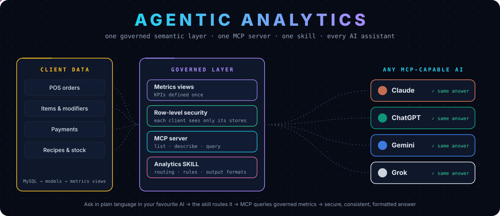
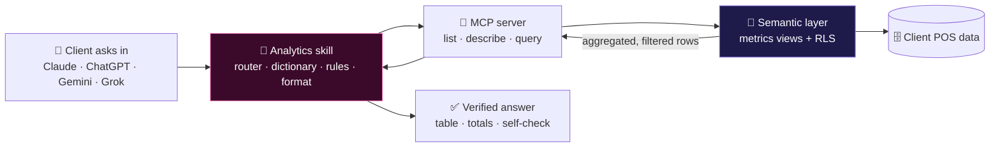
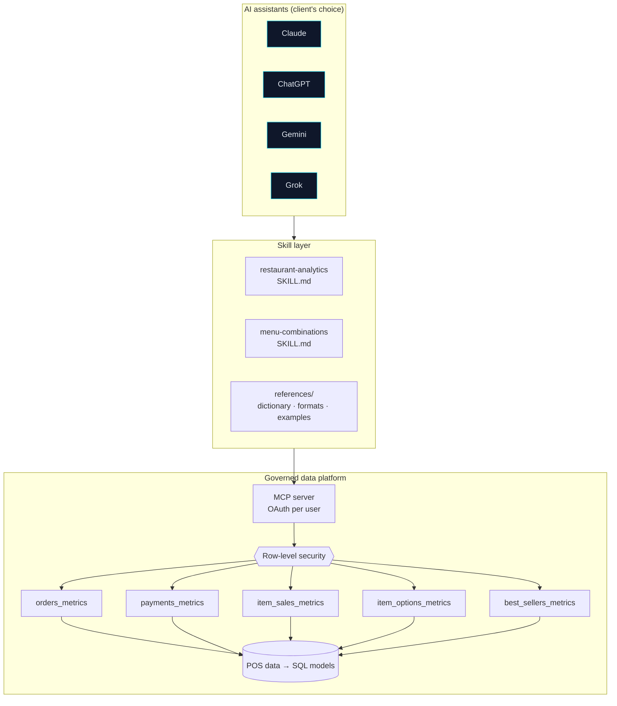
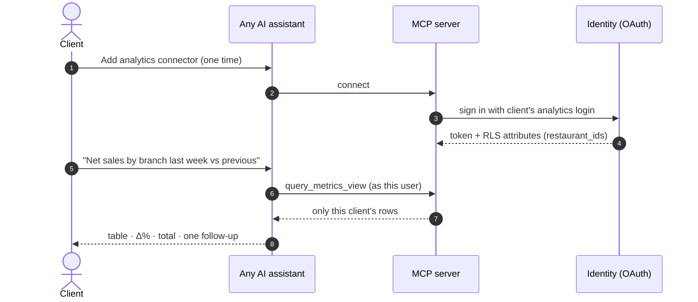
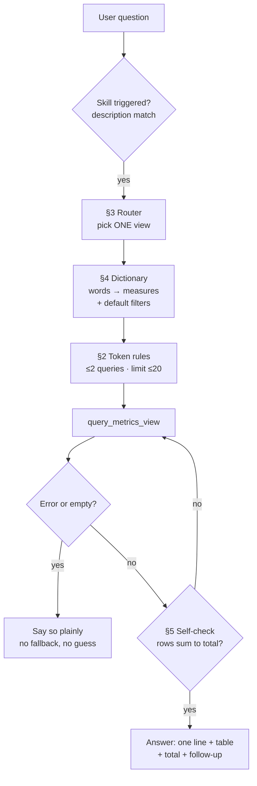
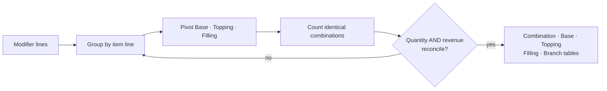
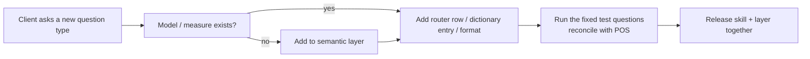
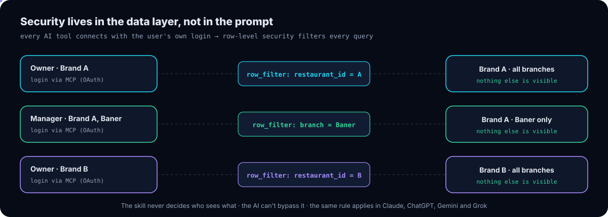

<p align="center">
  
</p>

<p align="center">
  
  
  
  
  
</p>

<h3 align="center">How we made restaurant analytics answerable from any AI assistant: securely, consistently, and in the format each client asks for.</h3>

> **About this repo.** It documents the agentic analytics setup I designed and run at work for restaurant clients: an MCP server on top of a governed semantic layer, plus **analytics skills** that teach any AI assistant how to use it correctly. Company and client names are removed; examples use synthetic numbers. The two skills in [`skills/`](skills) are ready-to-use generic versions.

---

## 📌 Contents

1. [The idea in one minute](#-the-idea-in-one-minute)
2. [Why the skill is the most important part](#-why-the-skill-is-the-most-important-part)
3. [Architecture](#%EF%B8%8F-architecture)
4. [One connector, every AI tool](#-one-connector-every-ai-tool)
5. [Anatomy of the analytics skill](#-anatomy-of-the-analytics-skill)
6. [The two skills](#-the-two-skills)
7. [Workflows step by step](#-workflows-step-by-step)
8. [Examples](#-examples)
9. [Data security & RLS](#-data-security--rls)
10. [Cleaner infrastructure for clients](#-cleaner-infrastructure-for-clients)
11. [Results](#-results)
12. [Repository structure](#%EF%B8%8F-repository-structure)
13. [Author](#-author)

---

## ⚡ The idea in one minute

| Before | After |
|---|---|
| Clients requested reports; the data team built them in a BI tool | Clients **ask their own AI assistant** in plain language |
| Every tool needed its own integration | **One MCP server** works in Claude, ChatGPT, Gemini, Grok and any MCP client |
| AI answers were inconsistent: wrong measures, wrong days, raw JSON | **The analytics skill** makes every answer follow the same rules and format |
| Security handled per report | **Row-level security** in the semantic layer applies to every query, in every tool |



---

## 🧠 Why the skill is the most important part

An MCP server gives an AI **access** to data. It doesn't give it **judgement**. Without a skill, a capable model still has to guess:

- *Which of 8 metrics views answers "net sales by channel"?*
- *Is "sales" gross or net? Do cancelled bills count?*
- *Is "yesterday" UTC or the restaurant's local business day?*
- *Should it return a table, a chart, or a JSON dump?*

Every guess is a chance to be confidently wrong, and a different AI tool guesses differently. **The skill turns the data team's knowledge into rules the agent follows every time.**

<p align="center">
  
</p>

| | Without skill | With skill |
|---|---|---|
| Views explored | all of them | **1** (router) |
| Tool calls | ~9 | **2** |
| Tokens | ~41k | **~6k** |
| Measure | guessed (often gross) | **governed net sales** |
| Business filters | often missing | **always applied** |
| Day boundaries | UTC | **store-local business date** |
| Output | raw JSON | **formatted table + total + self-check** |
| Same answer in every AI tool | ❌ | **✅** |

<sub>Illustrative figures from internal testing patterns; exact numbers vary by question and model.</sub>

---

## 🏗️ Architecture



| Layer | Owns | Changes when |
|---|---|---|
| **Semantic layer** | what every number means, and who can see it | a KPI definition or data source changes |
| **MCP server** | safe, typed access: list / describe / query | rarely |
| **Skill** | how to choose views, measures, filters and formats | a new question type or business rule appears |
| **AI assistant** | language, reasoning, conversation | whenever the client prefers another tool |

---

## 🌐 One connector, every AI tool

The same remote MCP server and the same skill files serve every assistant. Clients use the tool they already like; the data team maintains **one** integration.

| Tool | Connect the MCP server | Load the skill |
|---|---|---|
| **Claude** | custom connector (remote MCP URL) | upload the skill folder |
| **ChatGPT** | custom MCP connector (developer mode, plan-dependent) | project / custom GPT instructions + reference files |
| **Gemini** | Gemini CLI `mcpServers` setting | `GEMINI.md` context file |
| **Grok** | xAI API remote MCP tool | system prompt |
| **Any MCP client** | server URL | instructions + reference files |

📖 Step-by-step: [`docs/connect-ai-tools.md`](docs/connect-ai-tools.md)



---

## 🧬 Anatomy of the analytics skill

The skill follows the **standard agent-skill format**: a folder with a `SKILL.md` (YAML frontmatter + instructions) and a `references/` folder. It's loaded **progressively**: the agent always sees the short description, reads the core rules for each question, and opens reference files only when needed.

<p align="center">
  
</p>

<details open>
<summary><b>Frontmatter: decides when the skill loads</b></summary>

```yaml
---
name: restaurant-analytics
description: Answers restaurant sales, orders, channel, payment, item, modifier and
  top-seller questions from the governed metrics views exposed by the analytics MCP
  server. Use whenever the user asks about revenue, net sales, orders, AOV, branches,
  channels, payment methods, items sold, toppings/extras, kitchen time or "top selling"
  for their restaurants, in any language.
---
```
</details>

<details>
<summary><b>§3 Router: one question → one view</b></summary>

| The question is about… | View | Time column |
|---|---|---|
| revenue, net sales, orders, AOV, channels, branches, hours | `orders_metrics` | `order_timestamp` (store-local) |
| payment methods, tender | `payments_metrics` | `order_timestamp` |
| items sold, quantity, categories | `item_sales_metrics` | `order_timestamp` |
| toppings, extras, add-ons | `item_options_metrics` | `order_timestamp` |
| "top selling", best sellers | `best_sellers_metrics` | `sale_timestamp` |
</details>

<details>
<summary><b>§4 Dictionary: business words → exact measures</b></summary>

| User says | Measure | Default filter |
|---|---|---|
| net sales, revenue, ingresos | `net_revenue` | completed orders |
| sales, gross sales | `gross_revenue` | completed orders |
| orders, tickets | `order_count` | completed orders |
| tender, paid by | `amount_paid` | completed + paid |
| extras, toppings | `option_units` | completed, not deleted |
</details>

<details>
<summary><b>§5 Output: answers in the format the user asked for</b></summary>

1. One-line answer first, then the table
2. Dimension first, measures after, **sorted by the main measure**, with a **Total** row
3. Comparisons add `Previous` and `Δ %` and state the window
4. **Self-check:** breakdown rows must sum to the total, or re-query
5. One useful follow-up suggestion

If the user asks for something specific (*"just the number"*, *"as a chart"*, *"branch-wise only"*), that request overrides the default format.
</details>

📖 All 12 patterns: [`docs/skill-design-patterns.md`](docs/skill-design-patterns.md)

---

## 📚 The two skills

<table>
<tr>
<td width="50%" valign="top">

### 📊 [restaurant-analytics](skills/restaurant-analytics/SKILL.md)
**The analytics skill.** Covers sales, orders, AOV, channels, branches, payments, items, modifiers, top sellers and kitchen time.

- 5-view router
- business dictionary with gross vs net, default filters, store-local dates
- token rules (≤2 queries, small limits, no raw rows)
- locked table formats with totals and self-check
- "why do two reports differ?" explanations
- no silent fallbacks when a view errors

</td>
<td width="50%" valign="top">

### 🍦 [menu-combinations](skills/menu-combinations/SKILL.md)
**Built for a build-your-own dessert brand.** Answers *"which Base + Topping + Filling combinations sold?"*

- pivots modifier lines into combinations per item line
- standard output: combination-, base-, topping-, filling- and branch-wise
- **Quantity and Revenue must both reconcile** to the item totals
- never exposes menu list prices in sold-data output
- handles multi-topping lines and variants

</td>
</tr>
</table>

---

## 🔁 Workflows step by step

### A · Answering a question



### B · Menu combinations



### C · Shipping a new business rule



---

## 💬 Examples

| Ask (any language, any tool) | Router | What comes back |
|---|---|---|
| "How did Baner do last week by channel?" | orders | net sales, orders, AOV by channel + total |
| "Top 5 items this month vs last month" | top selling | ranked table with Δ % |
| "¿Cuánto se pagó con tarjeta ayer?" | payments | tender table, card first |
| "Average kitchen time by hour on Saturday" | orders | prep time by hour |
| "Which combinations of the Special bar sold most?" | menu-combinations | combination + topping + filling tables, reconciled |
| "Why don't item sales match total sales?" | dictionary | plain explanation (delivery & service fees) |

📄 Full transcripts: [`examples/with-and-without-skill.md`](examples/with-and-without-skill.md) · [`examples/menu-combinations-example.md`](examples/menu-combinations-example.md)

**Example query the skill produces:**

```json
{
  "metrics_view": "orders_metrics",
  "measures": [{ "name": "net_revenue" }, { "name": "order_count" }, { "name": "avg_order_value" }],
  "dimensions": [{ "name": "channel" }],
  "where": { "and": [{ "eq": ["branch_name", "Baner"] }, { "eq": ["order_status", "completed"] }] },
  "time_range": { "start": "2026-10-19", "end": "2026-10-26" },
  "sort": [{ "name": "net_revenue", "desc": true }],
  "limit": 20
}
```

---

## 🔐 Data security & RLS

<p align="center">
  
</p>

- **Every user signs in with their own account** (OAuth on the MCP server)
- **Row-level security in the semantic layer** filters every query before results exist
- **Aggregates only**: the MCP tools accept measures, dimensions and filters, never raw SQL or customer records
- **The skill never controls access.** It only reminds the agent of scope
- **Same rules in every AI tool**, because the filter lives below all of them

📖 Details: [`docs/security-rls.md`](docs/security-rls.md)

---

## 🧹 Cleaner infrastructure for clients

| For clients | For the data team |
|---|---|
| Stay in the AI tool they already use | One MCP server instead of one integration per tool |
| One login, one set of permissions | Business rules live in **one** skill, versioned with the semantic layer |
| Ask in their own words and language | No more one-off report requests |
| Answers in the format they ask for | Fixed test questions reconcile every release |
| Same numbers as their dashboards | New clients onboard with configuration, not code |

**Onboarding a client:** data in standard models → users with RLS attributes → share the MCP URL + OAuth → share or pre-install the skill → three smoke-test questions reconciled with the POS.

---

## 📈 Results

<table align="center">
<tr>
<td align="center"><h2>4+</h2>AI tools served by<br/>one connector</td>
<td align="center"><h2>1</h2>skill = consistent answers<br/>in every tool</td>
<td align="center"><h2>~2</h2>tool calls per question<br/>instead of ~9</td>
<td align="center"><h2>0</h2>access logic<br/>in prompts</td>
</tr>
</table>

---

## 🗂️ Repository structure

```text
agentic-analytics-skills/
├── skills/
│   ├── restaurant-analytics/
│   │   ├── SKILL.md                     # frontmatter + §1–§5 core rules
│   │   └── references/
│   │       ├── measure-dictionary.md    # gross vs net, why A ≠ B, edge cases
│   │       ├── output-formats.md        # locked table templates
│   │       └── examples.md              # worked queries
│   └── menu-combinations/
│       ├── SKILL.md                     # build-your-own combinations + self-check
│       └── references/combination-method.md
├── docs/
│   ├── connect-ai-tools.md              # Claude · ChatGPT · Gemini · Grok setup
│   ├── security-rls.md
│   └── skill-design-patterns.md         # 12 patterns that make skills reliable
├── examples/
│   ├── with-and-without-skill.md
│   └── menu-combinations-example.md
└── assets/                              # animated diagrams
```

## 🔗 Related

- [Analytics Studio](https://github.com/suyogpatil395/analytics-studio): AI report builder on the same semantic layer
- [Rill Client Analytics Platform](https://github.com/suyogpatil395/rill-client-analytics-platform): the source pipelines, models and metrics views underneath

---

## 👤 Author

<div align="center">

**Suyog Patil**
*Data Engineer · Agentic Analytics · Semantic Layers*

[](https://www.linkedin.com/in/suyog-patil-0089241b2/)
[](https://github.com/suyogpatil395)

⭐ If this helped you think about skills for agentic analytics, consider starring the repo.

</div>
